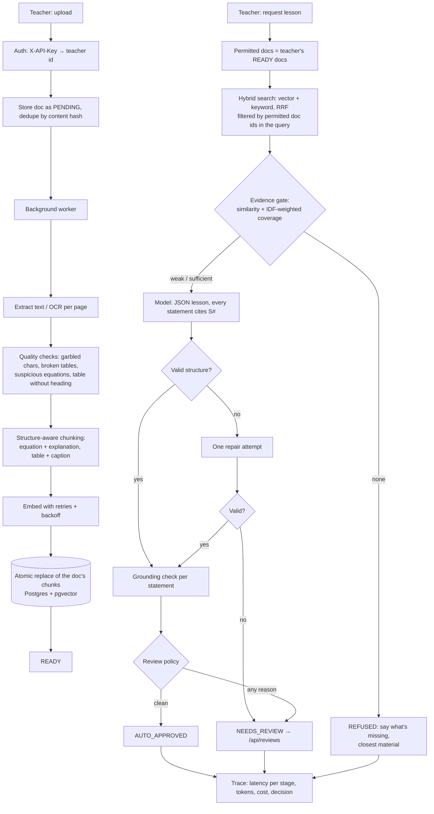

# mini-imboni

A small, working version of **Imboni**: teachers upload their own STEM material, then ask for a lesson plan. The lesson is built only from their documents and cites the passages it uses.

beyond "I built a RAG app":

| Question | Where it's answered |
|---|---|
| How do you know extraction worked (scans, equations, tables)? | Extraction checks + eval §1 |
| How good is retrieval, and did chunking choices matter? | Retrieval eval §2 (recall@5, MRR, "complete evidence") |
| What happens when the documents don't cover the request? | Evidence gate + eval §3 (false answers / false refusals) |
| How do you catch unsupported claims in the output? | Grounding checker + eval §5 (planted errors) |
| When does a person review a lesson? | Review policy, `/api/reviews`, eval §4 |
| Latency and cost? | Per-request traces, `/api/ops/summary`, eval §4 |
| Can one teacher's documents leak into another's lesson? | Permission filtering in the query + eval §2/§4 + tests |
| What if ingestion fails halfway? | Atomic chunk replacement + retries + eval §6 |

**Stack:** Java 21, Spring Boot 3.3, PostgreSQL + pgvector (or in-memory stores), PDFBox (+ optional tesseract OCR). Model and embeddings are pluggable: an **offline default** (no API key), OpenAI or Anthropic.

> **Honest scope.** The corpus is 8 dummy documents for 2 teachers, with 40 labelled requests. The default generator is an offline *extractive* stand-in. The retrieval, gate, extraction, permission and reliability numbers are real measurements of this code on that corpus. Real-model groundedness, latency and cost come from running the same eval with `IMBONI_LLM=openai`. A small corpus also makes retrieval easy: 100% recall here does **not** mean 100% on real teacher material.

---

## How a request flows



## The design decisions, and what measured them

**1. Extraction.** OCR misreads (`l/2` for `1/2`), lost superscripts and tables split from their headings are flagged per passage instead of silently indexed. Flags travel with the passage, and any lesson that cites a flagged passage goes to review. The scanned worksheet in the corpus is deliberately damaged. The eval checks the flags against hand-labelled fixtures and counts which equations survived extraction.

**2. Chunking.** The structure-aware chunker keeps an equation with the sentence that explains it, keeps a table with its caption, and records the section heading for citations. Compared with fixed 80-word windows, it lifted "complete evidence" (explanation and equation in one retrieved passage) from 86% to 100%.

**3. Retrieval.** Vector, keyword (BM25 / Postgres full-text) and hybrid (reciprocal rank fusion) are all measured. The offline embedder is feature hashing, not semantic, so keyword search and hybrid are compared rather than assumed worse. Permission filtering happens **inside** the search query (`document_id = ANY(?)`), and even BM25's statistics use only the caller's documents.

**4. Evidence gate.** A lesson is refused when the best similarity is too low **or** the request's key terms aren't covered. Coverage is IDF-weighted: for "Ohm's law" against a Newton's-laws corpus, "law" is covered but the rare, decisive "ohm" isn't, so the request is refused. Thresholds are swept on a dev split and reported on a test split. A false answer is scored as twice as costly as a false refusal.

**5. Grounding checker.** Runs on every statement, deterministically and cheaply:
- **Numbers:** every number must match the closest source sentence, counting repeats.
- **Term support:** ≥70% of the statement's content terms must be in the cited passages, otherwise it's weak or unsupported.
- **Negation:** the statement's negation must match its closest source sentence.
- **Mis-citation:** a statement only supported by a passage it didn't cite is marked weak.

Teaching instructions ("work in pairs") are allowed new words but not new numbers.

**6. When a person reviews.** NEEDS_REVIEW if any of these hold:
- an unsupported claim,
- more than 20% weak claims,
- weak evidence,
- output that failed the JSON/citation contract after one repair attempt,
- a citation to a passage with extraction warnings,
- gaps the model reported itself.

Each reason is recorded, so the review rate can be broken down by cause. Refusals are normal responses: they say what was missing and which documents came closest.

**7. Latency and cost.** Every request writes a trace: time per stage, model calls, tokens, cost at configured prices, evidence scores, decision and reasons. `/api/ops/summary` gives p50/p95 latency, cost per lesson, and review, refusal, error and cache-hit rates. Model calls have a hard timeout and bounded retries (only on 429/5xx/timeouts). The cache key includes the teacher id and the hash of every permitted document, so a cached lesson follows the same permissions and goes stale when documents change.

**8. Ingestion reliability.** Uploads are processed off the request thread with visible status. Embedding calls retry with backoff. Chunks have deterministic ids and are swapped in atomically, so a failure halfway stores nothing, and a retry never duplicates passages. The same file uploaded twice returns the existing document.

## Results (offline run)

Full report: [`docs/eval-report-offline.md`](docs/eval-report-offline.md). Regenerate with `mvn compile exec:java`.

| Stage | Result |
|---|---|
| Extraction checks | 9/10 damaged fixtures caught, 0/7 clean fixtures flagged. Missed: lost superscript (`v2` for `v²`). 2/4 equations intact in the scanned worksheet; both broken ones were flagged. |
| Retrieval (structure-aware + hybrid) | recall@5 100%, MRR 0.90, complete evidence 100% (fixed windows: 86%) |
| Permission leaks | 0 across 6 configurations × 40 requests; cross-teacher requests answered: 0 |
| Evidence gate (all 40) | 28/28 answerable answered, 11/12 unanswerable refused. One false answer: "multiplying and dividing fractions" (the corpus only covers adding/subtracting). |
| Planted errors caught | fabricated 100%, changed number 100%, flipped negation 100%, **term swap 8%** |
| Review routing | 28/28 lessons with planted errors went to review. 14 of 29 clean lessons went to review (7 cite the scanned worksheet, 7 have weak evidence). |
| Ingestion | transient failure absorbed by retry; failure halfway stored 0 partial passages; reprocess → 8/8 passages, 0 duplicates |

### What the eval changed (iteration log)

- **Number check v1 → v2.** v1 only asked whether each number appeared anywhere in the cited passage. Planted-error eval: 55% caught. It missed "mass 2 kg → 5 kg" because "5 kg" appears elsewhere in the passage. v2 matches numbers, counting repeats, against the closest source sentence: 100% caught, with no new false flags on correct statements.
- **Stemmer.** A test that should have produced a review produced a refusal. "evaporation" and "evaporate" didn't match, which lowered coverage. Aligning *-ation* and *-ate* fixed it.
- **Known blind spot: term swaps (8%).** "A larger force produces a larger *resultant*" passes because every word is in the source. Lexical checks can't see this. The next step is an entailment / LLM-judge check scored on the same planted set, and paying for it only on statements the lexical check passes.
- **Known gate miss.** "Multiplying fractions" gets through because "fraction" carries most of the coverage weight. A dev sweep suggests stricter thresholds (similarity 0.20, coverage 0.60). On the test split that fixes this request but refuses 2 answerable ones. That trade-off belongs to the product, so the default stays at 0.5 and the choice is documented.

## Running it

```bash
# tests: components, HTTP API, and the offline eval with quality floors (fails the build on regressions)
mvn test

# evaluation report → target/eval/report.md + results.json
mvn compile exec:java

# real model for generation (groundedness, latency and cost become real numbers)
IMBONI_LLM=openai OPENAI_API_KEY=sk-... mvn compile exec:java
IMBONI_LLM=anthropic ANTHROPIC_API_KEY=... IMBONI_LLM_MODEL=claude-haiku-4-5 mvn compile exec:java
IMBONI_EMBEDDING=openai ...   # real embeddings for retrieval

# the service, in-memory
mvn spring-boot:run

# the service on PostgreSQL + pgvector
docker compose up -d
SPRING_PROFILES_ACTIVE=pg mvn spring-boot:run
PG_TESTS=1 mvn test -Dtest=PgIntegrationTest
```

### API

```bash
K="X-API-Key: dev-key-alice"
curl -H "$K" -F file=@src/main/resources/corpus/alice/newtons_laws.md localhost:8080/api/documents     # 202, PENDING
curl -H "$K" localhost:8080/api/documents/{id}                                                         # READY + warnings
curl -H "$K" -H 'content-type: application/json' localhost:8080/api/lessons \
     -d '{"topic":"force, mass and acceleration","gradeLevel":"Grade 9","durationMinutes":45}'
curl -H "$K" localhost:8080/api/reviews                       # lessons waiting for a person
curl -H "$K" -H 'content-type: application/json' localhost:8080/api/reviews/{lessonId} -d '{"approve":true,"note":"ok"}'
curl -H "$K" localhost:8080/api/ops/summary                   # p50/p95, cost per lesson, review/refusal/error rates
```

## Layout

```
ingest/     Extractor (text/PDF/OCR), ExtractionQualityChecker, StructureAware + FixedWindow chunkers, IngestionService
retrieval/  Embedders (hashing, OpenAI, retrying), Retriever (vector/keyword/hybrid RRF), EvidenceGate
doc/        Document/Chunk, in-memory and Postgres+pgvector stores
lesson/     Prompt, StructureValidator, GroundingChecker, ReviewPolicy, LessonService, LessonStore
llm/        Offline extractive generator, OpenAI, Anthropic, HTTP client with timeout/retry
ops/        RequestTrace, TraceStore + summary
eval/       EvalRunner, NoisyLlm (planted errors), FlakyEmbedder (failure injection)
resources/  corpus/ (dummy docs per teacher), eval/ (40 labelled requests, extraction fixtures)
```

## Not done (and what I'd do next)

- Run the eval with a real model and real embeddings, then add a larger, real (permissioned) document set with teacher-labelled requests.
- LLM/entailment judge for statements the lexical checker passes, aimed at term swaps, measured on the planted set.
- Teacher evaluation of pedagogy (grade fit, timing). The review queue records approve/reject plus a note, which is the start of that data.
- Production basics: OIDC instead of API keys, Flyway migrations, lessons and traces in Postgres, metrics exported to Prometheus/Grafana, rate limits per teacher.
